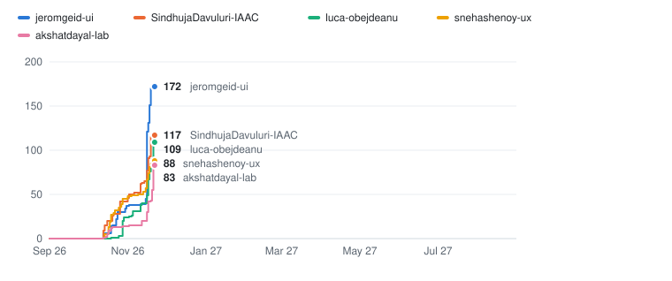
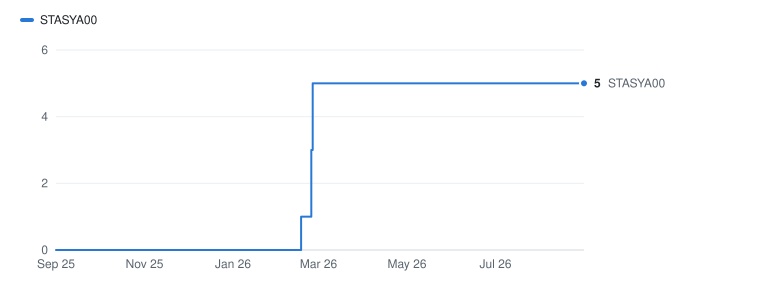
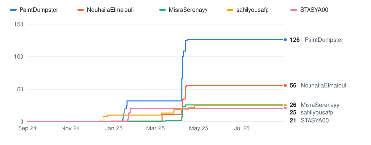

# Master in AI for Architecture and Business Innovation

**Institute for Advanced Architecture of Catalonia (IAAC) in collaboration with EADA Business School**

[![Models][models-badge]][hf-models]
[![Datasets][datasets-badge]][hf-datasets]
[![Downloads][downloads-badge]][hf-org]
[![Likes][likes-badge]][hf-org]

[![Hugging Face][hf-badge]][hf-org]
[![IAAC on GitHub][iaac-gh-badge]][iaac-gh]
[![iaac.net][iaac-web-badge]][iaac-programme]

> The Master in AI for Architecture and Business Innovation empowers future leaders to harness artificial intelligence for sustainable, resilient, and decarbonized urban transformation.

This is the GitHub organization of the **MaAI** programme at IAAC, Barcelona. It hosts the course repositories, student submissions and research studio projects. The trained models, datasets and demos live in our [Hugging Face organization][hf-org].

| Vertical themes | Transversal objectives |
|---|---|
| Urban Tech | Regenerative Design |
| Smart Construction | Carbon Neutrality |
| Natural Ecosystems | Co-Design |

---

## Course repositories

Each course has one main repository. Student and team work lives in its own repository inside this organization and is linked into the course repository as a git submodule.

### Term 1 · Smart Construction

| Course | Repository | Contents |
|---|---|---|
| **AI Methods I**: Machine Learning for the Built Environment | [![ai-methods-1-2026][repo1-badge]][repo1] | Lecture notebooks (Days 1 to 4), team submissions and the hackathon |
| **Operable Futures**: AI Systems for AEC (Research Studio) | [![operable_futures_research_studio_2026][repo2-badge]][repo2] | Studio brief and team projects under `projects/` |

### Term 2 · Urban Tech

| Course | Repository | Contents |
|---|---|---|
| **AI Methods II**: Deep Learning for Urban Tech | *coming soon* | |

## Explore

- 🤗 [Hugging Face organization][hf-org]: [models collection][hf-models] · [datasets collection][hf-datasets]
- 🏛️ [IAAC on GitHub][iaac-gh]: the main Institute for Advanced Architecture of Catalonia organization
- 🌐 [iaac.net](https://iaac.net) · [MaAI programme page][iaac-programme]

---

## Activity over time

  

### Top contributors per academic year

Click a year to open it.

<!-- years:start -->

<b>2026/27</b> · in progress

 

<b>2025/26</b>

 

<b>2024/25</b>

 

<!-- years:end -->

Commits across all public repositories in the organization, accumulated within each academic year (September to August) and reset to zero every 1 September. Refreshed daily by a GitHub Action. AI agents, bots and history imported from upstream projects are excluded.

<!-- Badges -->
[models-badge]: https://img.shields.io/badge/dynamic/json?url=https%3A%2F%2Fhuggingface.co%2Fapi%2Forganizations%2Fiaac-maai%2Foverview&query=%24.numModels&label=models&color=FFD21E&logo=huggingface&style=for-the-badge
[datasets-badge]: https://img.shields.io/badge/dynamic/json?url=https%3A%2F%2Fhuggingface.co%2Fapi%2Forganizations%2Fiaac-maai%2Foverview&query=%24.numDatasets&label=datasets&color=FFD21E&logo=huggingface&style=for-the-badge
[downloads-badge]: https://img.shields.io/badge/dynamic/json?url=https%3A%2F%2Fraw.githubusercontent.com%2Fiaac-maai%2F.github%2Fmain%2Fstats%2Fhf.json&query=%24.downloads&label=downloads&color=FFD21E&logo=huggingface&style=for-the-badge
[likes-badge]: https://img.shields.io/badge/dynamic/json?url=https%3A%2F%2Fraw.githubusercontent.com%2Fiaac-maai%2F.github%2Fmain%2Fstats%2Fhf.json&query=%24.likes&label=likes&color=FFD21E&logo=huggingface&style=for-the-badge
[hf-badge]: https://img.shields.io/badge/%F0%9F%A4%97%20Hugging%20Face-iaac--maai-FFD21E
[iaac-gh-badge]: https://img.shields.io/badge/GitHub-IaaC-181717?logo=github
[iaac-web-badge]: https://img.shields.io/badge/web-iaac.net-000000
[repo1-badge]: https://img.shields.io/github/stars/iaac-maai/ai-methods-1-2026?style=social&label=ai-methods-1-2026
[repo2-badge]: https://img.shields.io/github/stars/iaac-maai/operable_futures_research_studio_2026?style=social&label=operable_futures

<!-- Links -->
[hf-org]: https://huggingface.co/iaac-maai
[hf-models]: https://huggingface.co/collections/iaac-maai/2026-models-ai-methods-1
[hf-datasets]: https://huggingface.co/collections/iaac-maai/2026-datasets-ai-methods-1
[iaac-gh]: https://github.com/IaaC
[iaac-programme]: https://iaac.net/masters/master-in-ai-for-architecture-and-business-innovation/
[repo1]: https://github.com/iaac-maai/ai-methods-1-2026
[repo2]: https://github.com/iaac-maai/operable_futures_research_studio_2026
